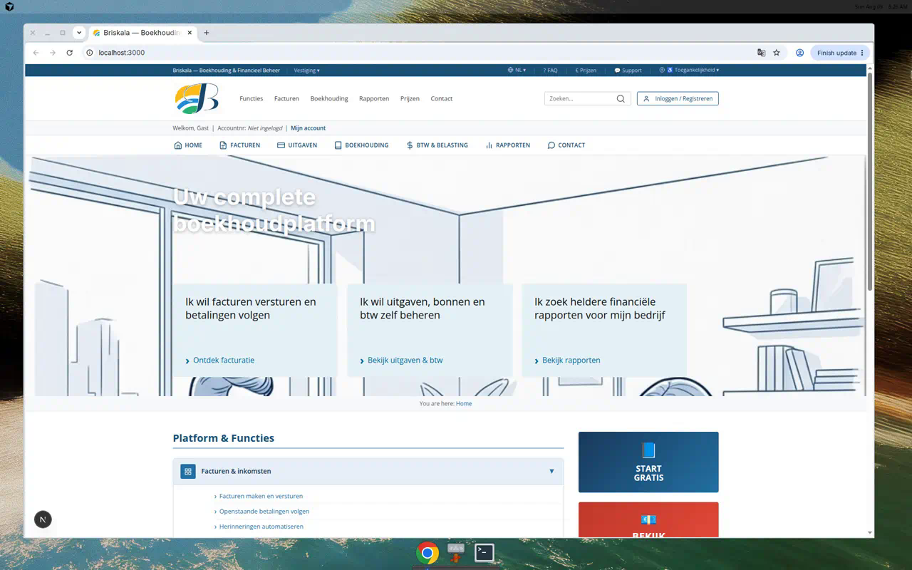
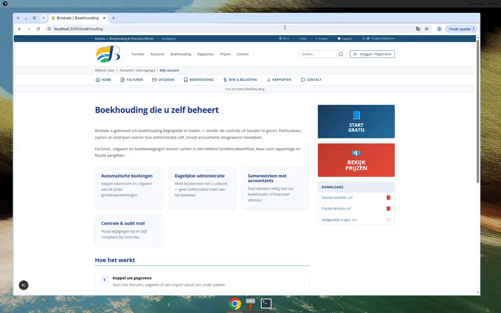
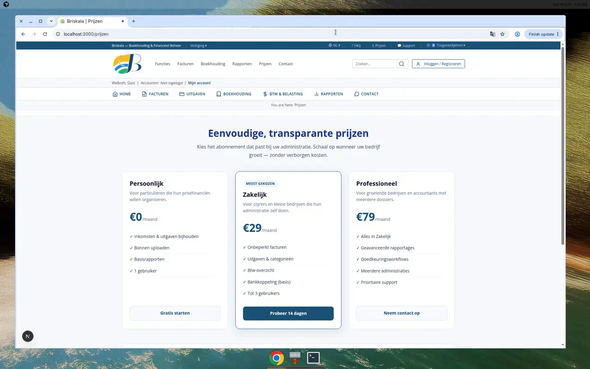
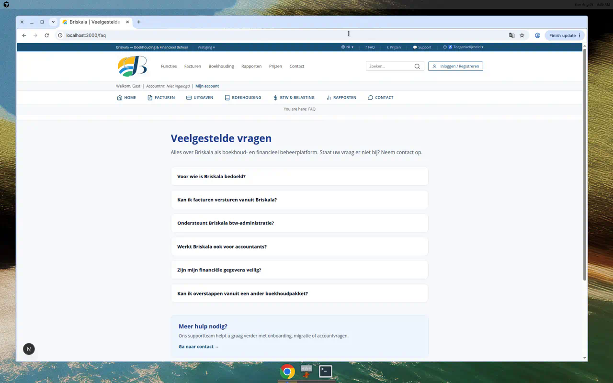
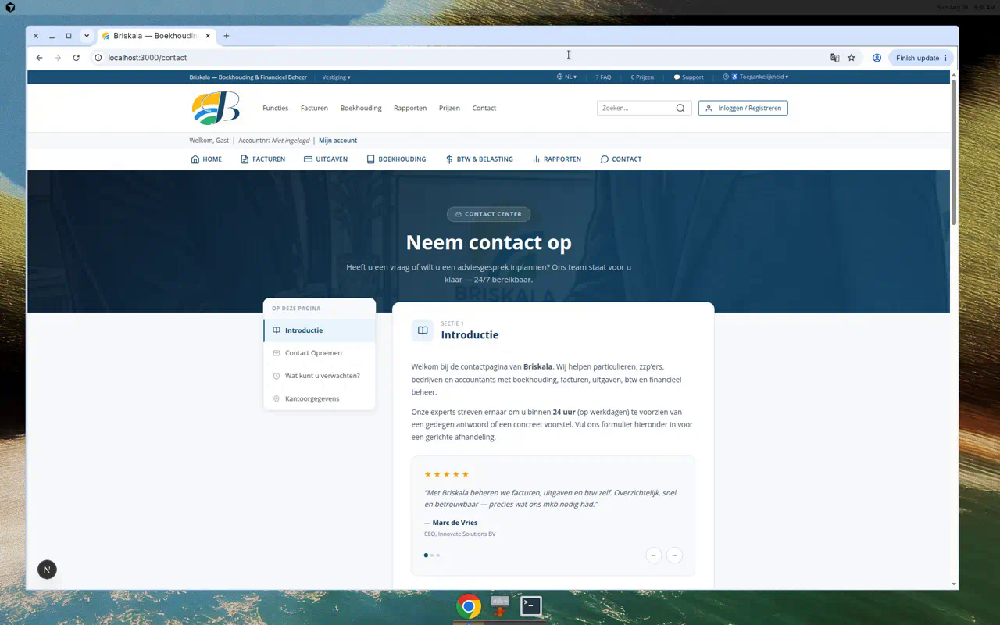
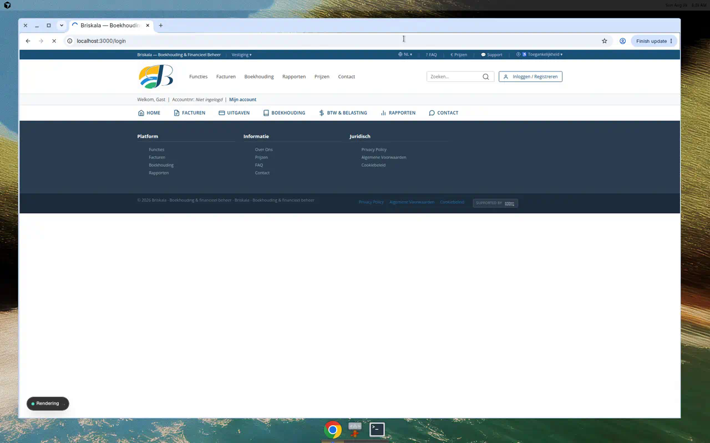
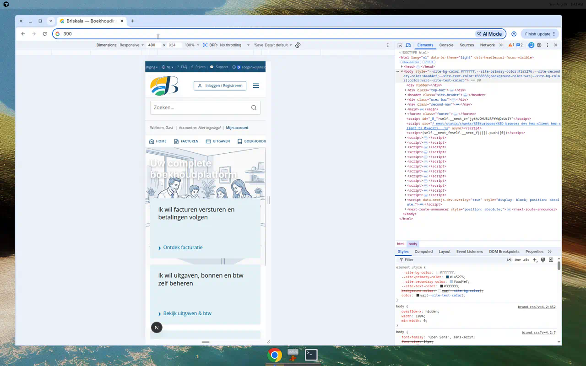

# Briskala

**Briskala** is a complete accounting and financial management platform. Individuals, freelancers, small and medium businesses, large organisations, and accountants can manage bookkeeping and financial administration themselves — from invoices and expenses to VAT and reports.

## What the platform does

Briskala helps users manage:

- **Invoices & income** — create, send, and track invoices through to payment  
- **Expenses & receipts** — register costs, upload receipts, and categorise spending  
- **Bookkeeping** — keep the ledger up to date with clear accounting workflows  
- **VAT / tax administration** — prepare overviews and stay on top of filing periods  
- **Financial reports** — profit & loss, cash flow, and business insights  
- **Documents** — store receipts, contracts, and financial files securely  

## Target users

| Audience | How Briskala helps |
|---|---|
| Individuals / personal users | Organise personal income, expenses, and admin |
| Self-employed & freelancers | Invoice clients and prepare VAT returns |
| Small businesses | Centralise invoices, receipts, and cash flow |
| Medium-sized businesses | Streamline workflows, approvals, and reporting |
| Large organisations | Scale processes with roles and controls |
| Accountants & advisors | Collaborate efficiently on shared administrations |

## Main features

- Facturen (invoices)  
- Uitgaven & bonnen (expenses & receipts)  
- Boekhouding (bookkeeping)  
- Btw & belastingen (VAT & tax)  
- Rapporten & inzichten (reports & insights)  
- Documentenarchief  
- Account dashboard (documents, messages, financial overview)  
- CMS-managed content via Payload Admin  

## Technology stack

| Layer | Technology |
|---|---|
| Framework | Next.js 16 (App Router) + React 19 |
| CMS / API | Payload CMS 3 |
| Database | SQLite / libSQL (`@payloadcms/db-sqlite`) |
| Auth (customers) | Firebase Auth |
| Auth (admin) | Payload Users |
| Styling | Bootstrap + custom brand CSS |
| Package manager | pnpm |
| Language | TypeScript |

## Screenshots

### Homepage



### Functies (features)


### Facturen


### Boekhouding



### Prijzen



### FAQ



### Contact



### Login



### Mobile homepage



## Demo video

A short walkthrough of the updated Briskala accounting platform:

- [docs/briskala-accounting-platform-demo.mp4](docs/briskala-accounting-platform-demo.mp4)

## Install and run

### Prerequisites

- Node.js `^18.20.2` or `>=20.9.0`
- pnpm `^9` or `^10`

### Setup

```bash
# Install dependencies
pnpm install

# Configure environment
cp .env.example .env
```

Edit `.env` with at least:

```env
PAYLOAD_SECRET=your-secret
DATABASE_URL=file:./briskala.db
# Optional Turso token when using a remote libSQL database:
DATABASE_AUTH_TOKEN=

# Firebase (customer login)
NEXT_PUBLIC_FIREBASE_API_KEY=
NEXT_PUBLIC_FIREBASE_AUTH_DOMAIN=
NEXT_PUBLIC_FIREBASE_PROJECT_ID=
NEXT_PUBLIC_FIREBASE_STORAGE_BUCKET=
NEXT_PUBLIC_FIREBASE_MESSAGING_SENDER_ID=
NEXT_PUBLIC_FIREBASE_APP_ID=
```

### Seed default content (optional)

```bash
# Load env vars in your shell, then:
pnpm exec tsx src/seed.ts
pnpm exec tsx src/seed-globals.ts
```

Default admin accounts (change immediately after first login):

| Email | Password |
|---|---|
| `admin@bpaGroup.com` | `SecurePassword123!` |

### Development server

```bash
pnpm dev
```

- Website: [http://localhost:3000](http://localhost:3000)  
- Admin: [http://localhost:3000/admin](http://localhost:3000/admin)  

## Build

```bash
pnpm build
pnpm start
```

## Useful scripts

| Script | Description |
|---|---|
| `pnpm dev` | Start Next.js development server |
| `pnpm build` | Production build |
| `pnpm start` | Serve production build |
| `pnpm lint` | Run ESLint |
| `pnpm test` | Run integration + e2e tests |
| `pnpm generate:types` | Regenerate Payload types |
| `pnpm generate:importmap` | Regenerate Payload import map |

## Project structure (high level)

```
src/
  app/(frontend)/     # Public website & account pages
  app/(payload)/      # Payload admin & API routes
  components/         # UI components
  content/briskala.ts # Canonical product messaging
  collections/        # Payload collections
  globals/            # Payload globals (nav, hero, footer, …)
  seed*.ts            # Seed scripts
docs/
  screenshots/        # README screenshots
  briskala-accounting-platform-demo.mp4
```

## License

MIT
